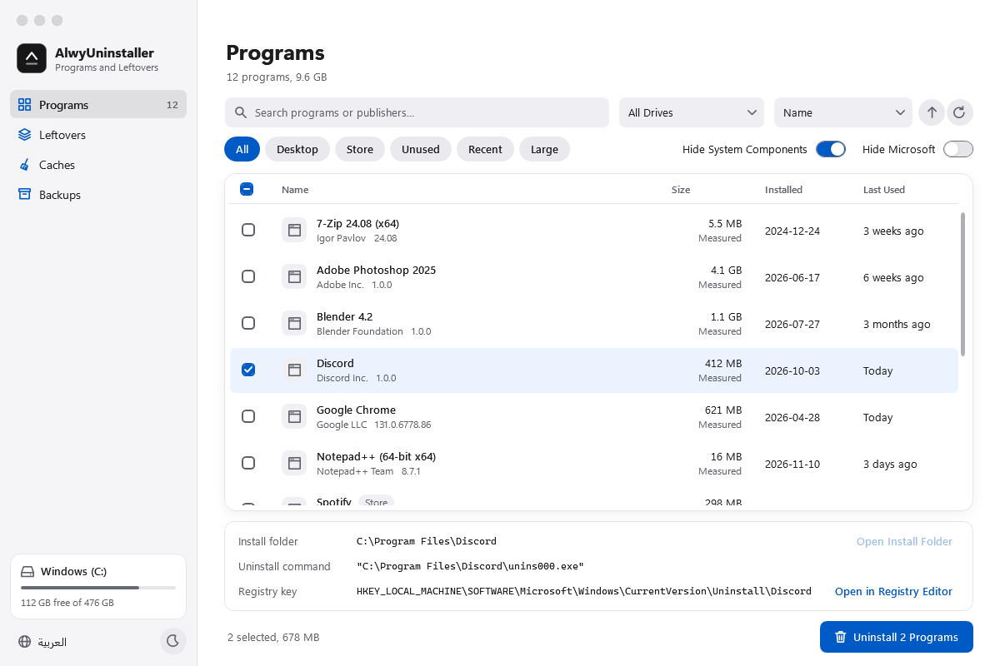
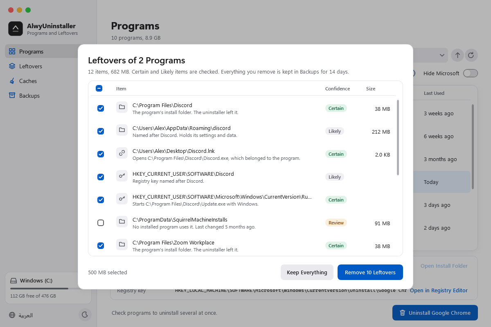
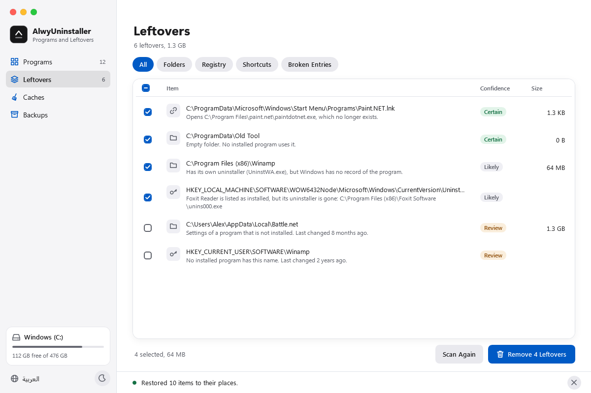
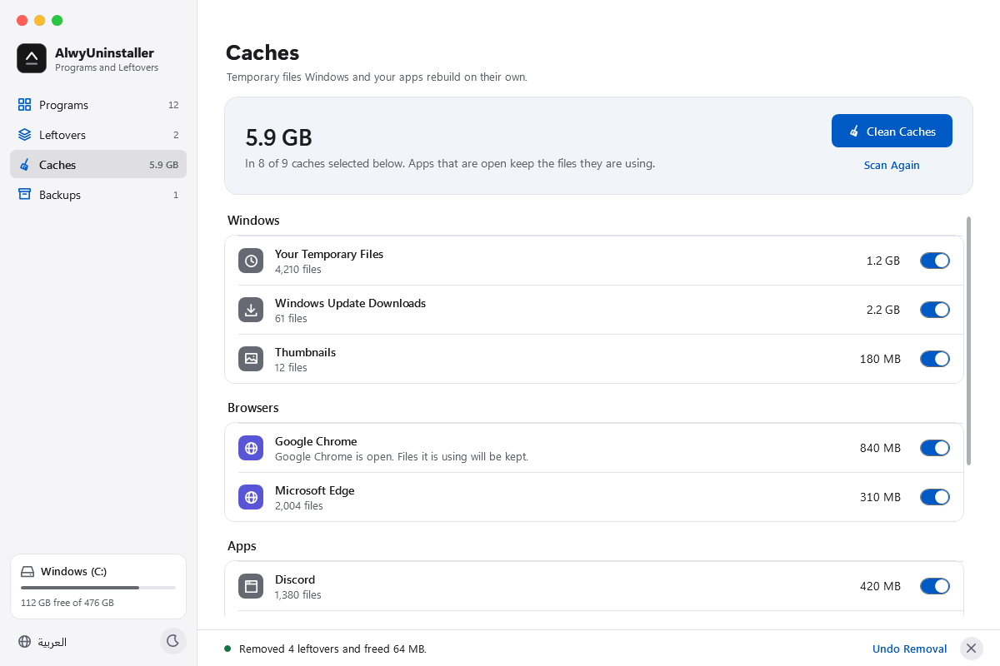
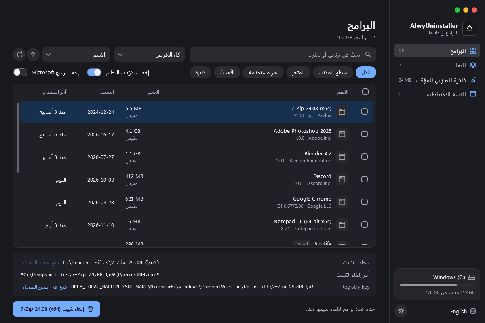

# AlwyUninstaller

A Windows uninstaller that removes a program together with what it leaves behind, finds leftovers of programs removed earlier, and cleans caches with one button. Every leftover it removes is kept for 14 days so you can put it back. English and Arabic interfaces are available.

**[Download the latest Windows release](https://github.com/hishamalwy/AlwyUninstaller-Releases/releases/latest)** · [Report a problem](https://github.com/hishamalwy/AlwyUninstaller-Releases/issues)

**Requirements:** Windows 10 version 2004 or later, or Windows 11, 64-bit. The app asks for administrator rights when it opens, because uninstallers, Program Files and the system registry need them.

> **Before you run it:** AlwyUninstaller is not digitally signed. Windows may display a security warning. A download hosted on GitHub is not a guarantee of safety. Review the release notes and decide whether you trust the application before running it. Do not disable Windows security protections to try it.

## Start here

1. Open the [latest release](https://github.com/hishamalwy/AlwyUninstaller-Releases/releases/latest).
2. Download `AlwyUninstaller-<version>-win-x64.zip` and extract it, or download `AlwyUninstaller-<version>-win-x64.exe` directly. It is portable: nothing is installed.
3. Open `AlwyUninstaller.exe` and review any Windows security warning before deciding whether to run it.
4. Try it first on a small program you don't need.

## Features

**Programs**
- Desktop programs and Store apps in one list, with icon, publisher, version, size, install date and when you last opened it
- Sizes measured on disk and marked **Measured** or **Reported**, because installers often report the wrong size
- Search, filters for Desktop, Store, Unused (not opened in 90 days), Recent (installed in 30 days) and Large (1 GB or more), and a drive picker with free space
- Sort by name, size, publisher, install date or last use
- Switches to hide system components and Microsoft apps
- Uninstall one program or several at once, without the uninstallers' own windows where MSI, Inno Setup and NSIS allow it
- Optional Windows restore point before uninstalling

**Leftovers**
- After each uninstall it looks for the install folder the uninstaller left, folders and registry keys named after the program or its publisher, shortcuts, startup entries and App Paths
- The Leftovers page finds what earlier removals left: program folders with an uninstaller Windows no longer knows, empty folders, broken uninstall entries, shortcuts to files that no longer exist, and old registry keys
- Each item has a confidence (Certain, Likely, Review) and a sentence saying why it belongs to the program; items to review are not selected

**Caches**
- One button cleans temporary files, Windows Update downloads, thumbnails, crash reports, browser caches (Chrome, Edge, Brave, Vivaldi, Opera, Firefox), app caches (Discord, Slack, Teams, VS Code, Cursor, Spotify), shader caches, and developer caches (npm, NuGet, pip, Yarn, Gradle; off by default)
- An app that is open is named, and the files it is using are kept

**Safety**
- Removed leftovers are moved to a backup first (files are moved, registry keys exported to .reg files) and kept for 14 days, with Undo right after and a Backups page to restore
- It never offers Windows folders, a drive root, your user folder, Program Files itself, or any folder another installed program uses, and it never follows junctions
- Running a program's own uninstaller and cleaning caches can't be undone; the app says so before it acts

**Interface**
- English and Arabic (fully mirrored), light and dark, Windows high contrast and Windows text size

## Help test AlwyUninstaller

If you try it, report what worked and what failed in [Issues](https://github.com/hishamalwy/AlwyUninstaller-Releases/issues). Useful details:

- App version and Windows version.
- The program you uninstalled, what you expected, and what happened.
- For a wrong leftover: its path and the reason the app showed.
- A screenshot or error message, with private information removed. Errors are logged in `%LocalAppData%\AlwyUninstaller\errors.log`.

Do not include passwords, access tokens or personal files.

## About this repository

This repository distributes AlwyUninstaller releases, screenshots, and documentation. See [releases](https://github.com/hishamalwy/AlwyUninstaller-Releases/releases/latest) for the current version and changes, and [PRIVACY.md](PRIVACY.md) for the privacy information.
